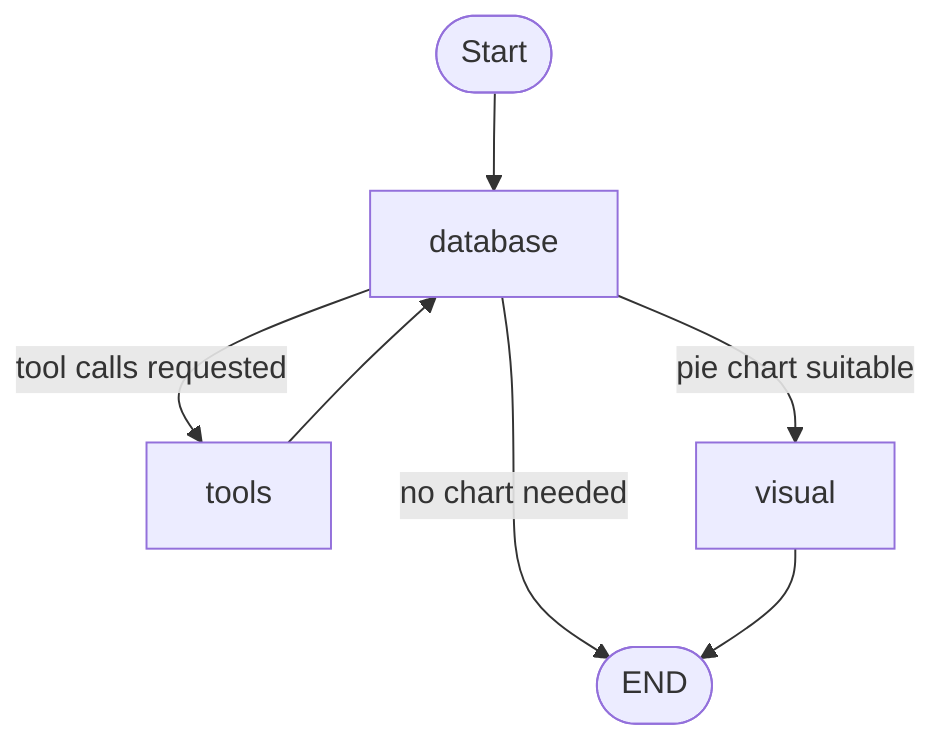

# LangChain Text-to-SQL Agent

A natural-language interface to a SQLite supermarket sales database, powered by Azure OpenAI. The project contains two implementations:

1. **Azure Function app (LangChain agent):** an HTTP API that turns a question into a read-only SQL query, runs it, and returns a concise answer.
2. **LangGraph multi-node workflow (new):** an enhanced version built as a graph. It keeps the text-to-SQL agent and adds an automatic decision step and a chart generation node that produces pie charts when the results suit one.

## What's New: LangGraph Multi-Node Workflow

`langgraph_multi_agent.py` re-implements the agent as a LangGraph `StateGraph` with separate nodes for database work, tool execution, and visualization.

### Graph Flow



### Nodes

| Node | Description |
| --- | --- |
| `database` | The LLM (with `get_table_info` and `execute_sql` tools bound) inspects the schema and writes SQL. Once the final answer is ready and the last query returned at least two rows, a classifier LLM call decides whether a pie chart is appropriate. |
| `tools` | A LangGraph `ToolNode` that executes the requested tool calls and loops back to `database` so the model can read the results. |
| `visual` | Asks the LLM to choose the category and numeric columns, validates them against the real data, groups small slices into "Other", and renders a PNG with matplotlib. |

### Pie Chart Decision

The classifier returns `true` only when the data shows a share of a whole: one categorical column, one non-negative numeric measure, a composition-style question, and roughly 2 to 8 categories (or data that can be grouped into that many). It returns `false` for time series, single values, many-metric tables, negative values, averages or rates, too many categories, and error or empty results.

### Graph State

| Field | Purpose |
| --- | --- |
| `messages` | Conversation history (appended with `add_messages`). |
| `needs_pie_chart` | Classifier decision that drives routing to `visual`. |
| `chart_reason` | One-sentence justification from the classifier. |
| `chart_path` | File path of the generated PNG. |
| `chart_data` | Labels, values, and title used for the chart. |

### Run the LangGraph Workflow

From the project root, with the virtual environment active and the Azure OpenAI settings available as environment variables:

```powershell
python langgraph_multi_agent.py
```

The script runs a sample question and prints a step-by-step trace of each node, followed by a summary. To try your own question, edit the call at the bottom of the file:

```python
final = run_with_trace("what are the total sales by Ship Mode?")
```

Generated charts are saved to the `charts/` folder as `pie_<id>.png`. The folder is created automatically.

Note: the Azure Function endpoint described below currently uses the original LangChain agent in `agents.py`. The LangGraph workflow runs as a standalone script.

## How the Original Function App Works

1. Send a question to the `text_to_sql_agent` HTTP endpoint.
2. The agent discovers the tables in `supermarket_sales.db`.
3. It calls `get_table_info` to inspect the relevant schema and sample rows.
4. It generates and executes a `SELECT` query with `execute_sql`.
5. The function returns the agent's final answer as plain text.

The system prompt allows only `SELECT` queries and instructs the agent not to modify the database.

## Prerequisites

- Python 3.10 or later
- Azure Functions Core Tools v4 (only needed for the function app)
- An Azure OpenAI resource with a deployment named `gpt-5.4`, or a matching deployment name configured in `agents.py` and `langgraph_multi_agent.py`
- Azure OpenAI credentials with permission to invoke the deployment

## Setup

1. Create and activate a virtual environment:

   ```powershell
   python -m venv .venv
   .\.venv\Scripts\Activate.ps1
   ```

2. Install the dependencies:

   ```powershell
   python -m pip install -r requirements.txt
   ```

   The LangGraph workflow additionally requires `langgraph`, `langchain-openai`, `langchain-core`, `pandas`, `matplotlib`, and `pydantic`. Make sure they are listed in `requirements.txt`.

3. Add the Azure OpenAI settings.

   For the function app, put them in `local.settings.json` under `Values`:

   ```json
   {
     "AZURE_OPENAI_API_KEY": "your-api-key",
     "AZURE_OPENAI_ENDPOINT": "https://your-resource.openai.azure.com/",
     "OPENAI_API_VERSION": "your-api-version"
   }
   ```

   For the standalone LangGraph script, set the same three values as environment variables, since `local.settings.json` is only read by the Functions host:

   ```powershell
   $env:AZURE_OPENAI_API_KEY = "your-api-key"
   $env:AZURE_OPENAI_ENDPOINT = "https://your-resource.openai.azure.com/"
   $env:OPENAI_API_VERSION = "your-api-version"
   ```

   Keep `local.settings.json` out of source control if it contains secrets. The existing `local.settings.json` contains only the Functions runtime settings, so Azure OpenAI values must be added before starting the function.

4. Confirm that `supermarket_sales.db` is in the project root. The application currently opens this file using a relative path.

## Run the Function App Locally

Start the Functions host from the project root:

```powershell
func start
```

The endpoint is:

```text
http://localhost:7071/api/text_to_sql_agent
```

Pass a question in the query string:

```powershell
Invoke-RestMethod -Method Get `
  -Uri "http://localhost:7071/api/text_to_sql_agent?question=What%20is%20the%20total%20sales%20by%20city%3F"
```

Or send it as JSON:

```powershell
Invoke-RestMethod -Method Post `
  -Uri "http://localhost:7071/api/text_to_sql_agent" `
  -ContentType "application/json" `
  -Body '{"question":"How many transactions are in the database?"}'
```

The function uses `FUNCTION` authorization. When deployed to Azure, include a function key using the `code` query parameter or an `x-functions-key` header.

## Project Structure

| File | Description |
| --- | --- |
| `function_app.py` | Defines the HTTP-triggered Azure Function and request handling. |
| `agents.py` | Creates and invokes the LangChain database agent. |
| `langgraph_multi_agent.py` | LangGraph workflow: database agent, tool loop, pie chart classifier, and chart rendering. |
| `get_prompts.py` | Loads prompt text (`load_system_prompt`) for the database and visual nodes. |
| `tools.py` | Provides SQLite schema inspection and SQL execution tools. |
| `helpers.py` | Reads the table names from the SQLite database. |
| `prompts/` | System prompts that define agent workflows and SQL restrictions. |
| `charts/` | Output folder for generated chart images (created at runtime). |
| `supermarket_sales.db` | SQLite database queried by the agent. |
| `host.json` | Azure Functions host configuration. |
| `local.settings.json` | Local Functions and environment settings (do not commit secrets). |
| `requirements.txt` | Python dependencies. |

## Notes

- Questions must be supplied as `question` in either the query string or JSON request body.
- Missing questions return HTTP `400`.
- Successful requests return the answer as plain text with HTTP `200`.
- Agent or database failures return a generic HTTP `500` response; detailed diagnostics are written to the Functions host logs.
- Conversation state in the function app uses an in-memory checkpointer, so it is lost when the Functions process restarts.
- The LangGraph workflow does not use a checkpointer; each run starts with a fresh state.
- Charts are only generated when the query result has at least two rows and the classifier judges a pie chart appropriate.